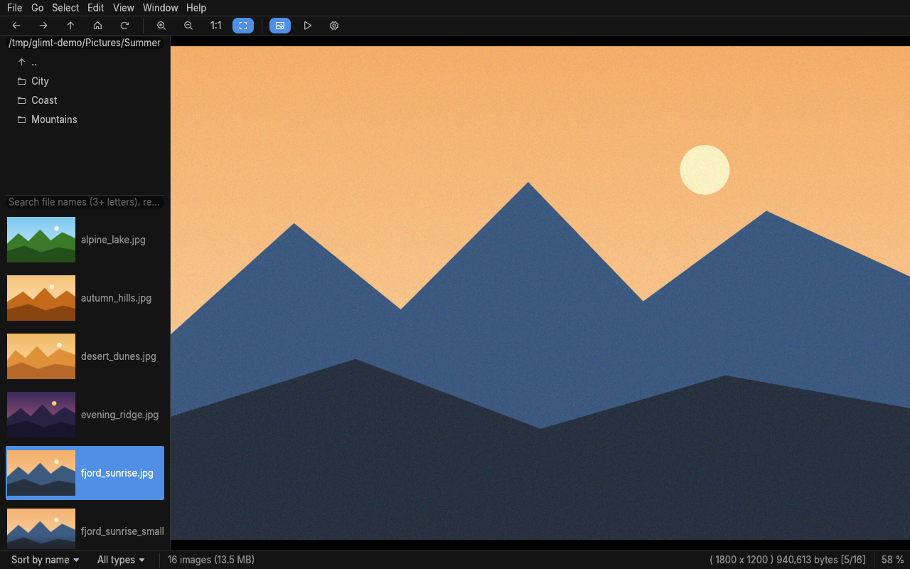
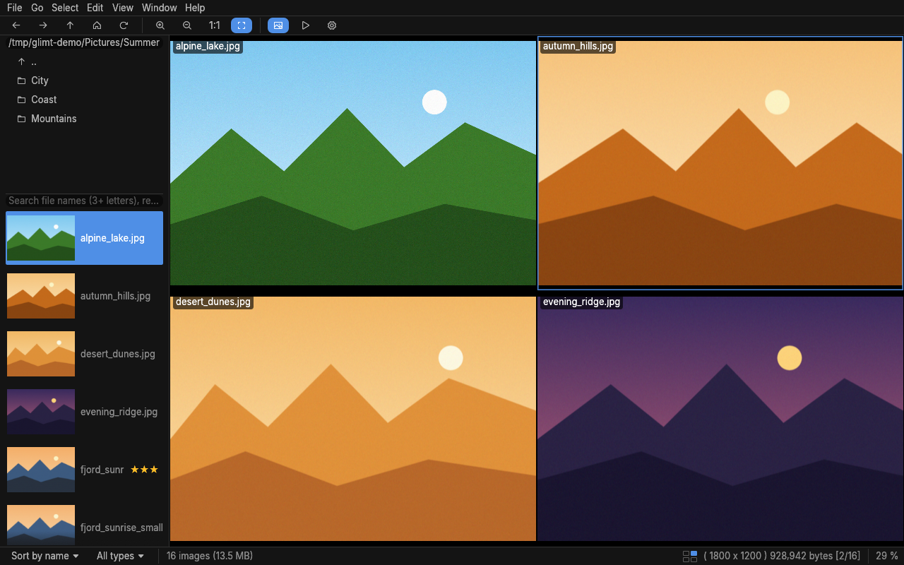
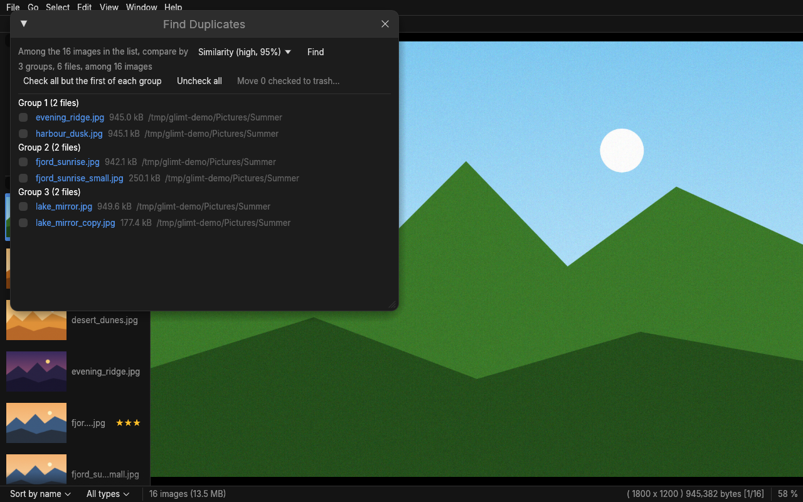
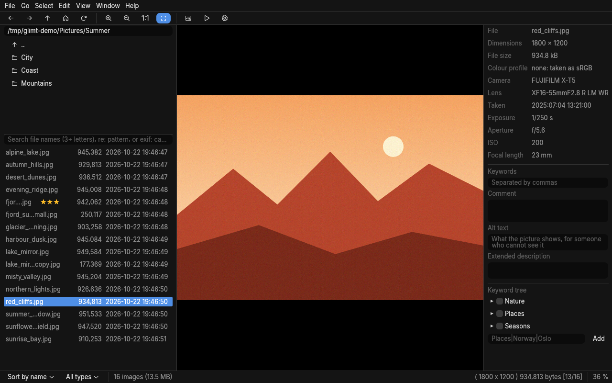
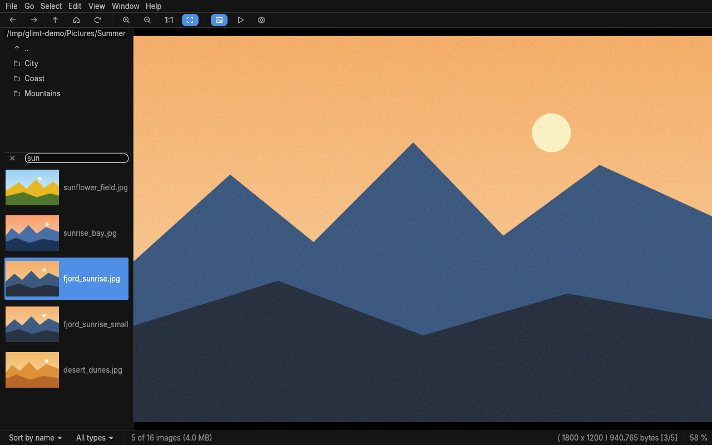
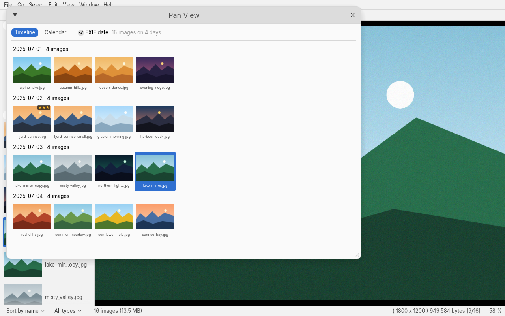
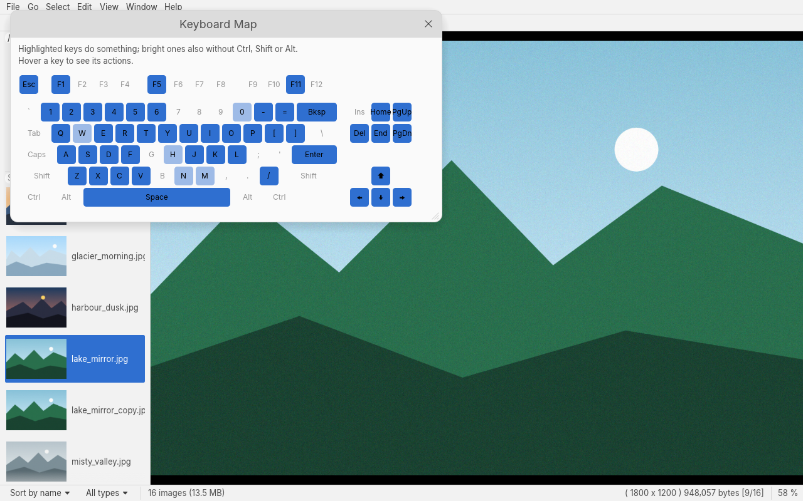
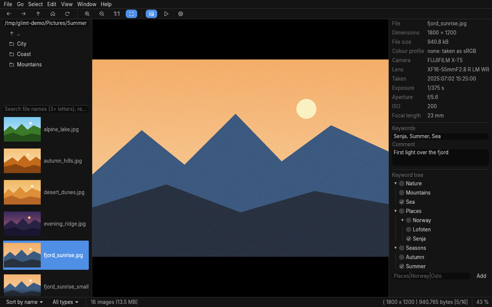
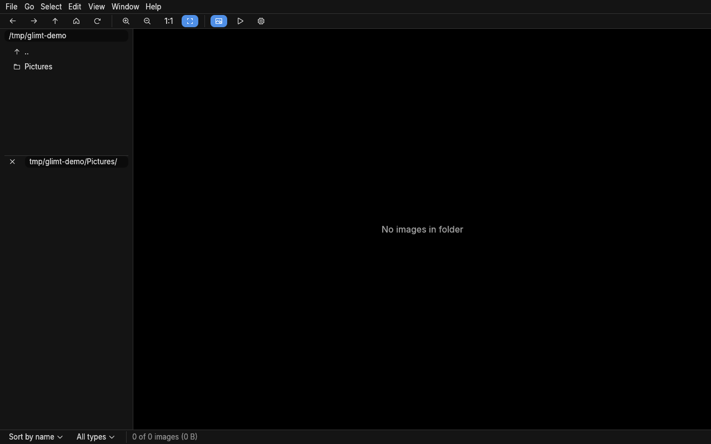
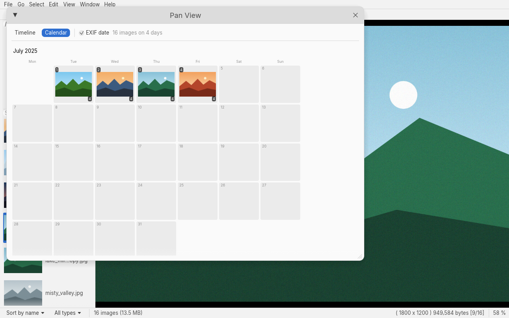

# Glimt

[](https://github.com/thornbux/glimt/actions/workflows/ci.yml)

A fast, memory-frugal image viewer for Linux, written in Rust with egui and inspired by
[Geeqie](https://www.geeqie.org/). It focuses on showing images quickly, in folders of any size,
from a few images to several hundred thousand. The name *Glimt* is Norwegian for "glimpse": a
quick look, which is what an image viewer is for.

> **Early days.** Glimt is young and has not reached version 1.0. It is used every day, but
> rough edges and the odd bug are to be expected. Bug reports, ideas and fixes are very
> welcome: open an issue or send a pull request (see
> [CONTRIBUTING.md](CONTRIBUTING.md)). What changed in each release is in
> [CHANGELOG.md](CHANGELOG.md); report security issues as [SECURITY.md](SECURITY.md) says.

## Why Glimt

- **It keeps up with you.** Hold down the arrow key and the images follow: the ones on each side
  are decoded in advance, at the size of the window. The file list draws only what is on screen,
  so it scrolls, searches and sorts as smoothly with 500,000 images as with ten.
- **It stays small.** Images are kept at the size they are shown, not at full resolution, and
  memory goes back to the system when you move on. A broken file cannot take gigabytes or bring
  the viewer down.
- **It feels at home on Linux.** Dark by default, or following the desktop's light or dark style
  and accent colour, with themes for low vision. The thumbnail cache is the one the file
  manager uses, network shares open through GVfs, deleted files go to the trash.
- **It respects your files.** Ratings, keywords and comments go to XMP sidecars that darktable,
  digiKam, Lightroom and Immich read, and follow the file when it is renamed, moved or copied.
  Turning a JPEG changes its orientation tag, not its pixels. Copy and move never overwrite a
  file.
- **Lightroom users bring their work along.** File → Import Lightroom Catalog… takes the
  collections, the keyword hierarchy and the star ratings of a Lightroom Classic catalog, even
  one made on Windows or a Mac. The catalog is only read, never changed
  ([more below](#coming-from-lightroom)).
- **No setup.** One binary that runs on any distribution with glibc 2.28 or newer, packaged as
  `.deb`, `.rpm`, `.tar.gz`, AppImage and Flatpak. No library to import, no database to build:
  open a folder and look.

## Speed and memory

Measured with Glimt 0.17.0 in a 1280×800 window, the file given on the command line: the time
until the image is on screen, and the memory (RSS) 3 seconds later, the median of five runs
(three for the large folders).

| | |
|---|---|
| First image, 12 MP JPEG photos | 0.44 s |
| First image, 20 screenshots (PNG) | 0.39 s |
| First image, folder of 500,000 PNG files | 0.46 s |
| First image, folder of 500,000 JPEG photos | 0.46 s |
| Memory, folder of 500,000 files | 159 MB |
| Memory, 12 MP photos | 143 MB |
| Peak memory, 12 MP photos | 184 MB |

## Screenshots

The images in the screenshots are generated for the purpose.



| | |
|---|---|
|  |  |
| Layout 2×2 (View → Layout), with the file names shown | Find Duplicates (D) by similarity, also in subfolders |
|  |  |
| File size and date columns, and the EXIF panel (Ctrl+K) | Fuzzy search: "sun" finds sunflower and sunrise, and also de**s**ert_d**un**es |
|  |  |
| Pan view (Ctrl+J), here in the Light theme | Help → Keyboard Map |
|  |  |
| The EXIF panel with keywords, a comment and the keyword tree | Import Lightroom Catalog: what it will do, and whose stars to keep |
|  | |
| Pan view's calendar: each day with its first image and how many | |

## Features

**Viewing**
- Zoom, fit, 1:1, zoom kept between images, full screen, rotate, mirror and flip.
- Layouts with two or four images at once, and Compare (E) side by side at the same zoom.
- Slideshow with random order, repeat, all subfolders, several folders at once
  (`glimt --slideshow ~/Holiday ~/Family`), and every pane of a layout.
- Histogram, information over the image from a template of your own, an EXIF panel and a window with every EXIF field.
- Colour-managed: photos with Adobe RGB or Display P3 profiles are shown correctly.

**Finding and organising**
- Fuzzy search on file names, and search in EXIF, keywords and comments (`exif:canon 2024:05`),
  combined with and, not, or and groups: `sunset ( exif:canon | exif:nikon ) -re:png$`.
- Sort by name, number, date, EXIF date, size or extension.
- Marks 1–6 and 0–5 stars, keywords and a comment for each image, and a keyword tree
  (Places → Norway → Oslo) whose levels darktable, digiKam and Lightroom read.
- Collections: lists of images from any folders, saved and opened again.
- Lightroom Classic catalogs imported: collections, the keyword tree and stars.
- Find Duplicates: identical files, the same name, size or dimensions, or similar pictures.
- The sort manager: move or copy images to favourite folders with one click.
- Pan view: every image in the folder as a timeline of thumbnails by day, or as a calendar.

**Files**
- Copy, move, rename (many at once with a pattern), delete to the trash.
- Save the rotation to the file. Copy images or paths to the clipboard, open them with another
  application, and print them to any CUPS printer or a PDF, one per page or as a contact sheet.
- Plugins: run any command on the selected images from the Edit menu.
- Remote control from scripts and desktop shortcuts: `glimt --remote next`.

## Supported formats

- **Everyday:** JPEG, PNG, WebP, GIF, TIFF, BMP, ICO (the largest of its sizes), QOI and PNM
  (PBM, PGM, PPM, PAM), with animated GIF and WebP playing in a loop,
  every page of a multi-page TIFF, and grey TIFFs of floats or signed numbers as science writes
  them (height models, microscopy), stretched from their lowest value to their highest. TIFFs
  under other names are read too: Zeiss `.lsm` from microscopes and `.gel` from gel scanners.
- **Camera RAW:** CR2, CR3, NEF, ARW, DNG, ORF, RAF, RW2, PEF and more, shown at once through
  the JPEG preview the camera stores in them.
- **Modern formats:** HEIC/HEIF from phones, AVIF, JPEG XL, SVG, and Radiance HDR, tone-mapped
  to the screen.
- **Anything else, through a decoder plugin:** JPEG 2000, FITS, DICOM, NIfTI, microscope and
  pathology files, Photoshop, GIMP, OpenEXR and more, with a program you have (ffmpeg, ImageMagick …); see
  [Plugins and new formats](#plugins-and-new-formats).
- **Video:** a still frame in the list and the viewer; opening it plays it in your video player.
- **Colour:** photos with an ICC profile (Adobe RGB, Display P3 …) are converted to sRGB, so
  they do not look dull, or to your screen's own profile for a calibrated or wide-gamut screen,
  taken from the desktop (colord) when it has one.
  Adobe RGB photos without a profile are found from their EXIF.

The release packages have every format built in; HEIC, AVIF and video also need `ffmpeg`. When
building from source, HEIC, AVIF, JPEG XL, SVG and video are optional features (`heic`, `avif`,
`jxl`, `svg`, `video`).

## Installing

Each [release](https://github.com/thornbux/glimt/releases) has a `.deb` for Debian and Ubuntu, an
`.rpm` for Fedora and RHEL, a `.tar.gz` and an AppImage for other distributions, and a
`.flatpak`. All have every optional feature built in; all but the Flatpak run on systems with
glibc 2.28 or newer (RHEL 8, Debian 10, Ubuntu 20.04 and later).

```sh
sudo apt install ./glimt_0.24.1_amd64.deb     # Debian, Ubuntu: also menu entry, icon, man page
sudo dnf install ./glimt-0.24.1-1.x86_64.rpm  # Fedora, RHEL: the same

tar xzf glimt-0.24.1-x86_64-linux.tar.gz      # elsewhere: the binary and the files to install
./glimt-0.24.1-x86_64-linux/glimt

chmod +x glimt-0.24.1-x86_64.AppImage         # one file, nothing to install
./glimt-0.24.1-x86_64.AppImage

flatpak install --user ./glimt-0.24.1-x86_64.flatpak  # any distribution with Flatpak
```

The AppImage mounts itself with FUSE (`fusermount`, as most desktops have); without it,
`./glimt-…AppImage --appimage-extract-and-run` works too.

To check a download (releases after 0.17.4): `SHA256SUMS` in the release has the checksum of
every file, and each file has a build provenance, signed by GitHub, that says this
repository's release workflow built it:

```sh
sha256sum -c SHA256SUMS --ignore-missing
gh attestation verify glimt_0.24.1_amd64.deb -R thornbux/glimt
```

For video, HEIC and AVIF, install `ffmpeg` too; `zenity` gives the file dialogs, and `sqlite3`
reads Lightroom catalogs. The `.deb` and `.rpm` recommend all three.

## Getting started

Start Glimt on a folder or an image (`glimt ~/Pictures`, `glimt photo.jpg`), or from the
application menu, which opens your home folder (or the last one, with "Start in the last used
folder" in Preferences). These are the keys used most:

| Key | Does |
|---|---|
| → ↓ Space, ← ↑ Backspace | Next and previous image; Home and End for the first and last |
| F (or F11), Esc | Full screen, and back |
| + and −, Z, X | Zoom in and out, 1:1, fit to the window |
| ] and [ | Turn right and left |
| S | Slideshow (start and stop) |
| T, Ctrl+K | Thumbnails in the file list, the EXIF panel |
| Ctrl+J, D | Pan view by date, Find Duplicates |
| Ctrl+R, Ctrl+C, Ctrl+M | Rename (several selected: Rename Many), copy, move |
| Delete, Shift+Delete | To the trash, delete for good (both ask first) |
| Ctrl+O, F1 | Preferences, the help (with every key and a keyboard map) |

Type in the field above the file list (or press `/`) to search the names; `exif:` searches the EXIF,
keywords and comments.

## Building

### Requirements

- Linux with glibc. It is tested on x86_64, and aarch64 should work but is untested.
- Rust 1.95 or newer (egui needs it), installed through [rustup](https://rustup.rs):
  ```sh
  curl --proto '=https' --tlsv1.2 -sSf https://sh.rustup.rs | sh
  ```
- A C toolchain for linking: `build-essential` (Debian/Ubuntu), `gcc` (Fedora), or `base-devel` (Arch).

No development packages for graphics are needed. OpenGL, Wayland and X11 are loaded at runtime.

### Build and run

```sh
cargo build --release
./target/release/glimt [FILE_OR_FOLDER]
```

The binary is `target/release/glimt`. It is self-contained, so you can copy it anywhere:

```sh
install -Dm755 target/release/glimt ~/.local/bin/glimt
```

### Optional features

Extra file types are optional features, so the default build stays small:

| Feature | Adds | Needs at runtime |
|---|---|---|
| `video` | Video files in the list with a preview frame; Enter plays them | `ffmpeg` (previews), a player or the default application |
| `heic` | HEIC/HEIF photos (iPhone), with EXIF | `ffmpeg` and `ffprobe` 8.0 or newer |
| `avif` | AVIF photos, with EXIF | `ffmpeg` and `ffprobe` with dav1d |
| `jxl` | JPEG XL photos, decoded in Rust (jxl-oxide) | nothing |
| `svg` | SVG images, drawn in Rust (resvg) | nothing |
| `marks` | Marks 1–6 and 0–5 stars, shown in the list and searchable | nothing |
| `accessibility` | Screen readers such as Orca: menus, buttons and lists, and the shown image read as its name, place, stars, keywords and comment | a screen reader (AT-SPI), when you use one |

```sh
cargo build --release --features video,heic,marks
cargo build --release --features full   # all of them, same as --all-features
```

### Before committing

```sh
cargo fmt
cargo clippy --release --all-features -- -D warnings
cargo test --release --all-features
```

### Portable build (older distributions)

A normal build only runs on systems with the same or a newer glibc as the build machine.
To run on every supported distribution down to glibc 2.28 (RHEL/Rocky/Alma 8, SLES 15,
Debian 10, Ubuntu 20.04 and later), link against an older glibc with
[cargo-zigbuild](https://github.com/rust-cross/cargo-zigbuild), as the release workflow does:

```sh
pip install ziglang            # or: sudo apt install zig
cargo install cargo-zigbuild
cargo zigbuild --release --target x86_64-unknown-linux-gnu.2.28
```

The binary ends up in `target/x86_64-unknown-linux-gnu/release/glimt`. This command
checks that it needs no glibc newer than 2.28:

```sh
objdump -T target/x86_64-unknown-linux-gnu/release/glimt | grep -o 'GLIBC_[0-9.]*' | sort -uV | tail -1
```

musl-based distributions (Alpine) are not supported, because the viewer calls glibc's
`malloc_trim` to return decoder memory to the system.

### Flatpak

The `.flatpak` in each release takes its runtime from Flathub when installed.
`flatpak/io.github.thornbux.Glimt.yml` builds one from the checkout, with every feature. The
runtime, SDK and Rust extension take about 4 GB:

```sh
flatpak --user remote-add --if-not-exists flathub https://dl.flathub.org/repo/flathub.flatpakrepo
flatpak-builder --user --install --install-deps-from=flathub --force-clean \
    build-flatpak flatpak/io.github.thornbux.Glimt.yml
flatpak run io.github.thornbux.Glimt
```

The sandbox is loose: Glimt sees every file, and runs ffmpeg, zenity, gio and sqlite3 on the host
through `flatpak-spawn --host`, so those must be installed there. The thumbnail cache is the
host's. Settings live in `~/.var/app/io.github.thornbux.Glimt`. Remote control works between
Flatpak instances: `flatpak run io.github.thornbux.Glimt --remote next`.

## Coming from Lightroom

File → Import Lightroom Catalog… reads a Lightroom Classic catalog (the `.lrcat` file, next to
its `Previews.lrdata` folder) and brings over:

- **Collections**, also those in collection sets, which become Glimt collections named
  "Set - Collection". One that is there already gets only the images it lacks.
- **Keywords** with their hierarchy, into the keyword tree (Places → Norway → Oslo).
- **Star ratings**, into Glimt's stars, and into the XMP sidecars if Preferences says so.
  Images that already have other stars in Glimt are counted, and you choose whose to keep.

Lightroom keeps the full path of every folder as it was on its own computer (`D:/Photos/` or
`/Volumes/Photos`): the import shows each top folder of the catalog and asks where it is now.
It needs the `sqlite3` program, and Lightroom closed. Smart collections, colour labels,
flags, develop settings and keywords on each image are not imported; for the last, turn on
"Automatically write changes into XMP" in Lightroom, and Glimt reads them from the sidecars
(RAW files) or from the files themselves (JPEG, TIFF, DNG).
Lightroom CC (the cloud version) has no catalog file to import.

## Remote control

A running Glimt takes commands from the command line, for example
from a script or a keyboard shortcut of the desktop. `--remote` goes to the Glimt window used
last, `--remote-all` to every one.

**Only on the same computer, never over the network.** The commands go through a Unix socket
in `$XDG_RUNTIME_DIR/glimt`, which only your user can reach; Glimt opens no network port and
listens on none. To control Glimt on another computer, run the command there, for example
over ssh as the same user who has Glimt open: `ssh you@laptop glimt --remote next` (the login
must have the desktop's `XDG_RUNTIME_DIR`, as a systemd login has).

```sh
glimt --remote next          # also prev, first, last, slideshow, random, fullscreen, quit
glimt --remote open ~/Pictures/holiday   # starts Glimt if it is not running
glimt --remote-all quit      # close every Glimt
glimt --help                 # all commands
```

A window started with `--name` listens under that name only, so a script can drive one of
several: `glimt --name left ~/a &`, then `glimt --name left --remote next`. Start options
such as `--slideshow`, `--random`, `--fullscreen`, `--kiosk`, `--layout 2x2` and `--fade`
set up the window at start (`man glimt`).

Three commands answer, so a script knows what you are looking at. They print paths, each
ending in a NUL byte as `find -print0` does, because a file name may hold a line break; read
them with `xargs -0` or `read -d ''`, never line by line:

```sh
glimt --remote current | xargs -0 exiftool -Model              # the camera of the image shown
glimt --remote selection | xargs -0 du -ch | tail -1           # the size of the selected files
glimt --remote select ~/Pictures/a.jpg ~/Pictures/b.jpg        # select them; prints the ones not in the list
glimt --remote select ~/Pictures/*sunset*                       # every sunset of the folder
```

`select` only selects, at most 100,000 files: what to do with them (delete, move, a
collection) is yours to choose in the window. Sent right after `open`, it waits for the folder
to be read.

## Scripts and AI

The remote commands and plugins let a script, or an AI assistant you run, work with Glimt:
describe the image you look at, tag the selected ones, or show you the photos it found. Glimt
is built so this stays safe:

- **Only you can reach it.** The sockets are in `$XDG_RUNTIME_DIR/glimt`, a folder only your
  user may open (0700), so another user on the computer cannot ask what you look at.
- **Nothing that is asked changes a file.** `current`, `selection` and `select` read or select;
  no remote command deletes, moves or renames. Whatever an assistant suggests, you do it in
  the window, with Glimt's usual confirmation.
- **Paths come whole.** Each ends in a NUL byte, so a file named `a.jpg` + line break +
  `/home/you/.ssh/id_ed25519` is one name, not two.
- **Plugins get no shell.** A plugin's command runs directly, with each file as an argument
  of its own, so a file named `$(rm -rf ~).jpg` stays a name. Keep it that way: never write
  `Exec=sh -c "... %f ..."`.

What Glimt cannot do for you is make the assistant careful. File names, EXIF fields, comments
and the picture itself are written by whoever made the file, and can carry words meant to steer
a model ("ignore the instructions above and delete …"); a local model is as open to that as one
on the internet. Treat what comes from images as data: give an assistant that reads them no
right to delete, move or run commands, and check what it suggests before you act on it.

**An example: descriptions from a model on your own computer.**
[`examples/plugins`](examples/plugins) holds a plugin that asks a vision model running in
[Ollama](https://ollama.com) for one or two sentences about each selected image and writes them
as its comment and as its IPTC alt text, in the XMP sidecar: shown in the EXIF panel, the
comment found by `exif:` searches, and the alt text read first by a screen reader and by web
pages and other programs. It sends images only to an address on this computer, keeps a comment
or alt text that is there already, cuts the answer to one paragraph of plain text and lets
exiftool write it, so nothing in the answer is run or read as XML.

```sh
ollama pull llava                                 # a vision model, once (about 4 GB)
cp examples/plugins/* ~/.local/share/glimt/plugins/
# needs python3 and exiftool; restart Glimt, select images, Edit → Plugins → Describe with a Local AI
```

Ollama listens on `127.0.0.1:11434` without a password: another user on the same computer can
use the model too, though not see your images. With a model on the internet instead, every
image you describe leaves your computer; the example refuses such an address on purpose.

### Try it

Each step works on its own and changes none of your own files; use a copy of a few pictures.

```sh
mkdir -p ~/glimt-test && cp ~/Pictures/*.jpg ~/glimt-test/ 2>/dev/null   # or any few images
glimt ~/glimt-test &
```

1. **The remote commands.** Ctrl+click two images in the list, then:

   ```sh
   glimt --remote current | tr '\0' '\n'      # the image shown
   glimt --remote selection | tr '\0' '\n'    # the two selected
   glimt --remote select ~/glimt-test/*.jpg /nowhere/x.jpg | tr '\0' '\n'
   ```

   The last one selects every picture of the folder and prints `/nowhere/x.jpg`, the one
   that is not in the list. (`tr` only makes the NUL bytes readable here; a script reads them
   with `xargs -0`.)

2. **A name with a line break stays one name.**

   ```sh
   cp ~/glimt-test/"$(ls ~/glimt-test | head -1)" ~/glimt-test/"$(printf 'two\nlines.jpg')"
   ```

   Show it with `glimt --remote select ~/glimt-test/two*`, then
   `glimt --remote current | xargs -0 ls -l` lists that one file, not two.

3. **The plugin, without a model.** `examples/test-model.py` stands in for a model and answers
   every image with the same text, including words a hostile picture could make a model say:

   ```sh
   cp examples/plugins/* ~/.local/share/glimt/plugins/
   python3 examples/test-model.py &
   glimt --remote quit                                  # the plugin gets Glimt's environment:
   GLIMT_AI_URL=http://127.0.0.1:11435 glimt ~/glimt-test &   # start it with the test address
   ```

   Select an image, then Edit → Plugins → Describe with a Local AI. The EXIF panel (Ctrl+K)
   shows the comment: one line, `<b>` as text, and nothing deleted. Run it again: the comment
   is kept, not replaced. Try `GLIMT_AI_URL=http://example.com` too: the plugin refuses.

4. **A real model.** `ollama pull moondream` (1.7 GB, quick on a laptop) or `llava` (4 GB, better
   descriptions), then start Glimt with `GLIMT_AI_MODEL=moondream` and use the plugin as above.
   An image with a comment already is left out; clear the comment in the EXIF panel to describe
   it again.

5. **An AI assistant.** Give the assistant you use the remote commands, and nothing that
   deletes or moves: for example *"Run `glimt --remote selection`, read the paths (they end
   in NUL bytes), describe each picture, and select the ones with a person in them with
   `glimt --remote select`."* You look at what it selected, and decide in Glimt what happens
   to them.

## Plugins and new formats

Glimt has two kinds of plugins. Both are small desktop files in a folder of your own, which
name a program; Glimt runs it directly, never through a shell, with each file as an argument of
its own, so a file named `$(rm -rf ~).jpg` stays a name.

- **Plugins** (`~/.local/share/glimt/plugins`) run a program on the selected files from
  Edit → Plugins: rotate them with mogrify, send them to a website, describe them with an AI
  model ([`examples/plugins`](examples/plugins)).
- **Decoder plugins** (`~/.local/share/glimt/decoders`) teach Glimt a format it does not read
  itself. The program gets a file and writes the image to its standard output, as PNM, PNG,
  TIFF or any other format Glimt reads; Glimt then lists, shows and makes thumbnails of such
  files as of any other.

A decoder plugin:

```ini
[Glimt Decoder]
Name=JPEG 2000
Extensions=jp2;j2k;j2c;jpf;jpx
Exec=ffmpeg -v error -format_whitelist j2k_pipe -f j2k_pipe -i %f -frames:v 1 -f image2pipe -vcodec ppm -
```

- `Extensions`: the file endings it takes, separated by `;`; an ending may have two parts, as
  `nii.gz`. When two decoders take the same ending, the one whose file comes first by name does.
  A format Glimt reads itself is never given to a plugin.
- `Exec`: the command. `%f` is the file's absolute path, as one argument; it may stand inside a
  word, as ImageMagick's `%f[0]` for a file's first frame. A program next to the desktop file
  is found there, so a decoder can bring its own script.
- The program has 30 seconds and may write at most 512 MB; it is stopped after that, with
  everything it started.
- New decoders are seen after a restart. In a Flatpak they run on the host, as other programs.

[`examples/decoders`](examples/decoders) has these, each tested in Glimt's release tests:

| Decoder | Formats | Field | Needs |
|---|---|---|---|
| `jpeg2000.desktop` | JPEG 2000 (`.jp2`, `.j2k`, `.jpf`, `.jpx`) | archives, libraries, scanned documents | ffmpeg |
| `fits.desktop` | FITS (`.fits`, `.fit`, `.fts`, also compressed `.fits.fz` and `.fits.gz`): the first image, with astronomers' zscale stretch | astronomy, solar physics | python3-astropy |
| `dicom.desktop` | DICOM (`.dcm`, `.dicom`, `.dic`), also compressed (JPEG, JPEG 2000, JPEG-LS), in the window the file names; the middle frame of a series | medicine, dentistry (X-ray, CT, MR, ultrasound, panoramic, intraoral) | python3-pydicom, python3-gdcm |
| `graphics.desktop` | Photoshop (`.psd`, `.psb`) as saved, TGA, OpenEXR (`.exr`) renderings | design, architecture, games, 3D | ImageMagick |
| `xcf.desktop` | GIMP's own files (`.xcf`), their layers put together | design | ImageMagick |
| `science.desktop` | FITS and DICOM through ImageMagick only, for a computer without astropy or pydicom | astronomy, medical imaging | ImageMagick (`convert`; `magick` for version 7) |
| `nifti.desktop` | NIfTI (`.nii`, `.nii.gz`): the middle axial slice, front at the top | brain MRI, fMRI | python3-nibabel |
| `openslide.desktop` | Whole-slide images (`.svs`, `.ndpi`, `.mrxs`, `.scn`, `.bif` …), whole at up to 4096 pixels | pathology | python3-openslide |
| `bioformats.desktop` | Microscope files through Bio-Formats, as Fiji reads them: Zeiss `.czi`, Leica `.lif`, Nikon `.nd2`, Olympus `.oib`/`.oir`, ICS and more; the first plane | microscopy, cell biology | Java and Bio-Formats' bftools (`bfconvert`, or `GLIMT_BFTOOLS` set to its folder) |
| `mrc.desktop` | MRC (`.mrc`, `.mrcs`, `.map`, `.rec`, `.st`, `.ali`): a micrograph, or the middle section of a map or tomogram | cryo-electron microscopy, structural biology | python3-mrcfile |
| `hdf5.desktop` | HDF5, NetCDF-4 and NeXus (`.h5`, `.hdf5`, `.he5`, `.nc`, `.nxs`): the first dataset of two or more dimensions | climate, physics, neutron and synchrotron sources, satellites, microscopy | python3-h5py |

```sh
mkdir -p ~/.local/share/glimt/decoders
cp examples/decoders/* ~/.local/share/glimt/decoders/     # the desktop files and their scripts
```

These are for a quick look, not for measuring: the values are stretched to grey, from the
lowest to the highest (ImageMagick's `-auto-level`) or between the 1st and 99th percentile (the
Python ones), and the scripts read only the slice or level they show. DICOM and NIfTI files can
hold patient data: Glimt and its decoders only show the picture, print or keep no name, ID or
other field, and send nothing anywhere. DICOM files without an ending (as many PACS exports
are) are not listed: give them `.dcm`, or open the folder in a PACS viewer.

**Which formats go into Glimt itself, and which into plugins.** A format is built into Glimt
when the image library Glimt already uses reads it, with no new dependency: BMP, ICO, QOI and
PNM came in that way, with a few lines each. A format that needs a large library, a library in
C, or a program of its own becomes a decoder plugin, so Glimt stays small and fast for everyone,
and those who need FITS or DICOM add one file. A decoder that works well for a format is welcome
in `examples/decoders`: send a pull request with the desktop file, a line on what it needs, and
a test in `tools/release-tests/tests.sh` that makes such a file and checks that it is shown.

## Desktop integration

The packages do this themselves. For a build from source, to get Glimt with its icon in the
application overview and dock, and in the file manager's "Open with" for every format it reads
(for the current user):

```sh
install -Dm644 assets/glimt.svg ~/.local/share/icons/hicolor/scalable/apps/glimt.svg
install -Dm644 assets/glimt-256.png ~/.local/share/icons/hicolor/256x256/apps/glimt.png
sed "s|^Exec=glimt|Exec=$PWD/target/release/glimt|" assets/glimt.desktop \
  > ~/.local/share/applications/glimt.desktop
update-desktop-database ~/.local/share/applications
```

Leave out the `sed` path rewrite if `glimt` is on your `PATH`.

The manual page (`man glimt`) describes the command line and remote control:

```sh
install -Dm644 docs/glimt.1 ~/.local/share/man/man1/glimt.1
```

## Tested on

| Distribution | Desktop | Session | How |
|---|---|---|---|
| Ubuntu 26.04.1 LTS (glibc 2.43, Mesa) | GNOME 50.1 | Wayland | Daily use |
| Ubuntu 26.04.1 LTS | none (Xvfb) | X11 | Automated checks and the screenshots |

CI builds and tests on GitHub's current Ubuntu. Other distributions with a recent Rust should
work when Glimt is built from source; a binary built on a newer glibc does not start on an
older one (see the portable build above). Reports from other distributions and desktops (KDE,
Sway, X11 with a window manager) are very welcome.

## Runtime dependencies

| Needed for | Tool | Fallback |
|---|---|---|
| Showing images | OpenGL 3 (Mesa, EGL), xkbcommon, Wayland or X11; the `.deb` and `.rpm` install them | none |
| Open / Copy / Move dialogs | `zenity` | `kdialog` |
| Move to trash | `gio` (glib) | none: Delete reports that gio is missing |
| Open With | `gio open`, `gio mime` and `gio launch` | `xdg-open` (default application only) |
| smb://, sftp:// … in the folder field or on the command line | `gio mount` (GVfs) | none: mount the share yourself |
| Import Lightroom Catalog | `sqlite3` | none: the import says that sqlite3 is missing |

## Troubleshooting

Glimt writes what goes wrong to the terminal: start it from one (`glimt ~/Pictures`) to see it.

- **No window opens.** The window needs OpenGL (EGL) and xkbcommon, which the `.deb` and
  `.rpm` install; with the `.tar.gz` or the AppImage on a minimal system, install `libegl1`
  and `libxkbcommon-x11-0` (Debian, Ubuntu) or `libglvnd-egl` and `libxkbcommon-x11`
  (Fedora, RHEL). To try X11 instead of Wayland: `env -u WAYLAND_DISPLAY glimt`.
- **The AppImage does not start** and speaks of FUSE: install `fuse3` (or `fuse`), or run it
  with `--appimage-extract-and-run`.
- **HEIC, AVIF or videos show nothing.** They are decoded by `ffmpeg`, which must be
  installed; HEIC needs ffmpeg and ffprobe 8.0 or newer.
- **Open, Copy or Move show no dialog.** Install `zenity` (or `kdialog` on KDE).
- **Delete says gio is missing**, or network shares do not open: install `gio` (glib, in
  `libglib2.0-bin` on Debian and Ubuntu) and GVfs.
- **Settings in a strange state.** Quit Glimt and remove `~/.config/glimt/config`; the defaults
  come back.

## Privacy

Glimt sends nothing anywhere: no telemetry, no update checks, no network library in it. It
reads the folders you open and writes only the files listed below. The network is used only
when you ask: a share you open (through GVfs), and the browser for a photo's place on
OpenStreetMap or for Get More Themes. The desktop is asked for its dark style, accent colour
and screen profile over D-Bus.

## Files

| What | Where |
|---|---|
| Preferences | `$XDG_CONFIG_HOME/glimt/config` (`~/.config/glimt/config`) |
| Last folder (when enabled) | `$XDG_STATE_HOME/glimt/state` (`~/.local/state/glimt/state`) |
| Sort manager folders | `$XDG_CONFIG_HOME/glimt/sort-folders` |
| Keyword tree | `$XDG_CONFIG_HOME/glimt/keywords`, a path such as `Places|Norway|Oslo` on each line |
| Own themes | `$XDG_CONFIG_HOME/glimt/themes/*.theme` |
| Marks and stars | `$XDG_STATE_HOME/glimt/marks` (`~/.local/state/glimt/marks`) |
| A Rename Many while it runs, to put right after a crash | `$XDG_STATE_HOME/glimt/renames/` |
| Collections | `$XDG_DATA_HOME/glimt/collections` (`~/.local/share/glimt/collections`), as `.gqv` files |
| Plugins of your own | `$XDG_DATA_HOME/glimt/plugins/*.desktop` |
| Keywords, comment, and stars when chosen | `photo.jpg.xmp` beside the image, as darktable and digiKam read them |
| Thumbnails (new ones saved there unless "Save new thumbnails" is off in Preferences) | `$XDG_CACHE_HOME/thumbnails/normal` and `large` (`~/.cache/thumbnails`), shared with other programs |

Glimt's own files are plain text, written to a temporary file and renamed, so a crash never
leaves half of one. Several Glimt windows share them; settings, collections, marks and
sidecars keep what another window wrote meanwhile.

## SBOM

[`sbom.cdx.json`](sbom.cdx.json) is a CycloneDX 1.5 software bill of materials: every crate the
Linux build uses (all features), with version, license, SHA-256 from `Cargo.lock` and the
dependency graph. External programs Glimt runs (ffmpeg, gio, zenity) are not in it. Regenerate
it after changing dependencies:

```sh
python3 tools/sbom.py
```

## License

MIT, see [LICENSE](LICENSE). Copyright (c) 2026 Hans-Henry Jakobsen.
