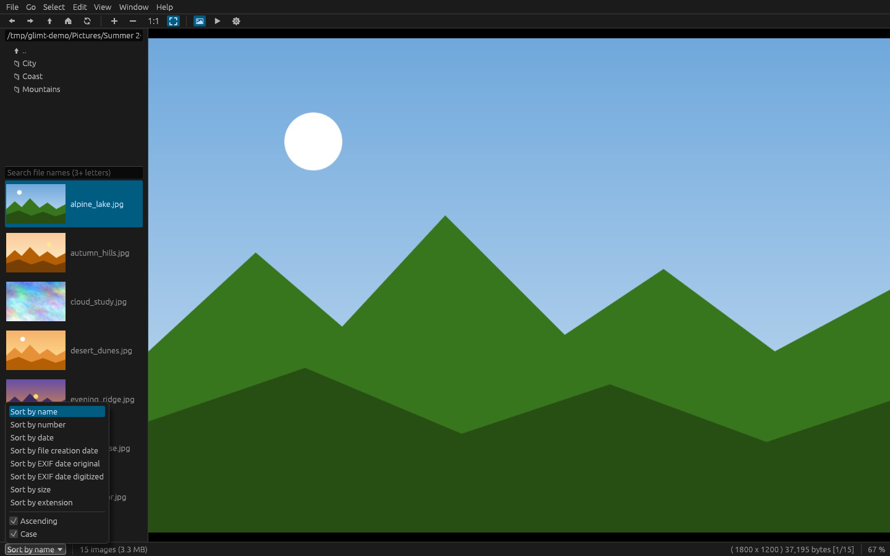

# Glimt

[](https://github.com/thornbux/glimt/actions/workflows/ci.yml)

A fast, memory-frugal image viewer for Linux, written in Rust with egui and inspired by
[Geeqie](https://www.geeqie.org/). It has far fewer features than Geeqie. It focuses on
showing images quickly and handles folders of any size, from a few images to several
hundred thousand. The name *Glimt* is Norwegian for "glimpse": a quick look, which is what an image viewer is for.

> **Early days.** Glimt is young and has not reached version 1.0. It is used every day, but
> rough edges and the odd bug are to be expected. Bug reports, ideas and fixes are very
> welcome: open an issue or send a pull request (see
> [CONTRIBUTING.md](CONTRIBUTING.md)).

## Screenshots

The images in the screenshots are generated for the purpose.


| | |
|---|---|
|  |  |
| File size and date columns, and the EXIF panel (Ctrl+K) | Fuzzy search: "sun" finds sunflower and sunrise, and also de**s**ert_d**un**es |
|  |  |
| The sort menu in the status bar | Help → Keyboard Map |

## Building

### Requirements

- Linux with glibc. It is tested on x86_64, and aarch64 should work but is untested.
- Rust 1.88 or newer (edition 2024, let chains), installed through [rustup](https://rustup.rs):
  ```sh
  curl --proto '=https' --tlsv1.2 -sSf https://sh.rustup.rs | sh
  ```
- A C toolchain for linking: `build-essential` (Debian/Ubuntu), `gcc` (Fedora), or `base-devel` (Arch).

No development packages for graphics are needed. OpenGL, Wayland and X11 are loaded at runtime.

### Build and run

```sh
cargo build --release
./target/release/glimt [FILE_OR_FOLDER]
```

The binary is `target/release/glimt`. It is self-contained, so you can copy it anywhere:

```sh
install -Dm755 target/release/glimt ~/.local/bin/glimt
```

### Optional features

Extra file types are optional features, so the default build stays small:

| Feature | Adds | Needs at runtime |
|---|---|---|
| `video` | Video files in the list with a preview frame; Enter plays them | `ffmpeg` (previews), a player or the default application |
| `heic` | HEIC/HEIF photos (iPhone), with EXIF | `ffmpeg` and `ffprobe` 8.0 or newer |
| `avif` | AVIF photos, with EXIF | `ffmpeg` and `ffprobe` with dav1d |
| `jxl` | JPEG XL photos, decoded in Rust (jxl-oxide) | nothing |
| `svg` | SVG images, drawn in Rust (resvg) | nothing |
| `marks` | Geeqie's marks 1–6 and 0–5 stars, shown in the list and searchable | nothing |

```sh
cargo build --release --features video,heic,marks
cargo build --release --features full   # all of them, same as --all-features
```

### Before committing

```sh
cargo fmt
cargo clippy --release --all-features -- -D warnings
cargo test --release --all-features
```

### Portable build (older distributions)

A normal build only runs on systems with the same or a newer glibc as the build machine.
To run on every supported distribution down to glibc 2.28 (RHEL/Rocky/Alma 8, SLES 15,
Ubuntu 22.04, Debian 12), link against an older glibc with
[cargo-zigbuild](https://github.com/rust-cross/cargo-zigbuild). This build has not been tested yet:

```sh
pip install ziglang            # or: sudo apt install zig
cargo install cargo-zigbuild
cargo zigbuild --release --target x86_64-unknown-linux-gnu.2.28
```

The binary ends up in `target/x86_64-unknown-linux-gnu/release/glimt`. This command
checks that it needs no glibc newer than 2.28:

```sh
objdump -T target/x86_64-unknown-linux-gnu/release/glimt | grep -o 'GLIBC_[0-9.]*' | sort -uV | tail -1
```

musl-based distributions (Alpine) are not supported, because the viewer calls glibc's
`malloc_trim` to return decoder memory to the system.

## Remote control

As with `geeqie --remote`, a running Glimt takes commands from the command line, for example
from a script or a keyboard shortcut of the desktop. `--remote` goes to the Glimt window used
last, `--remote-all` to every one:

```sh
glimt --remote next          # also prev, first, last, slideshow, fullscreen, quit
glimt --remote open ~/Pictures/holiday   # starts Glimt if it is not running
glimt --remote-all quit      # close every Glimt
glimt --help                 # all commands
```

## Desktop integration

To get Glimt with its icon in the application overview and dock (for the current user):

```sh
install -Dm644 assets/glimt.svg ~/.local/share/icons/hicolor/scalable/apps/glimt.svg
install -Dm644 assets/glimt-256.png ~/.local/share/icons/hicolor/256x256/apps/glimt.png
sed "s|^Exec=glimt|Exec=$PWD/target/release/glimt|" assets/glimt.desktop \
  > ~/.local/share/applications/glimt.desktop
update-desktop-database ~/.local/share/applications
```

Leave out the `sed` path rewrite if `glimt` is on your `PATH`.

## Runtime dependencies

| Needed for | Tool | Fallback |
|---|---|---|
| Showing images | OpenGL 3 (Mesa), Wayland or X11 | none |
| Open / Copy / Move dialogs | `zenity` | `kdialog` |
| Move to trash | `gio` (glib) | none: Delete reports that gio is missing |
| Open With | `gio open`, `gio mime` and `gio launch` | `xdg-open` (default application only) |
| smb://, sftp:// … in the folder field or on the command line | `gio mount` (GVfs) | none: mount the share yourself |

## Files

| What | Where |
|---|---|
| Preferences | `$XDG_CONFIG_HOME/glimt/config` (`~/.config/glimt/config`) |
| Last folder (when enabled) | `$XDG_STATE_HOME/glimt/state` (`~/.local/state/glimt/state`) |
| Thumbnails (read; written only with "Save new thumbnails" on) | `$XDG_CACHE_HOME/thumbnails/normal` (`~/.cache/thumbnails/normal`), shared with other programs |

The first two are plain `key=value` text files written atomically.

## Supported formats

JPEG, PNG, WebP, GIF and TIFF; animated GIF and WebP play in a loop. Camera RAW files (CR2, CR3,
NEF, ARW, DNG, ORF, RAF, RW2, PEF and more) show the JPEG preview the camera stores in them. HEIC/HEIF with the `heic` feature, AVIF with `avif`, JPEG XL with `jxl`, SVG with `svg`. Photos with an ICC profile (Adobe RGB,
Display P3 …) are converted to sRGB, so they do not look dull.

## SBOM

[`sbom.cdx.json`](sbom.cdx.json) is a CycloneDX 1.5 software bill of materials: every crate the
Linux build uses (all features), with version, license, SHA-256 from `Cargo.lock` and the
dependency graph. External programs Glimt runs (ffmpeg, gio, zenity) are not in it. Regenerate
it after changing dependencies:

```sh
python3 tools/sbom.py
```

## License

MIT, see [LICENSE](LICENSE). Copyright (c) 2026 Hans-Henry Jakobsen.
