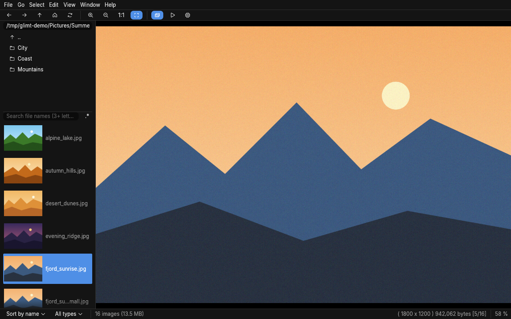

# Glimt – an image viewer

[](https://github.com/thornbux/glimt/actions/workflows/ci.yml)

A fast, memory-frugal image viewer for Linux, written in Rust with egui and inspired by
[Geeqie](https://www.geeqie.org/). It shows images quickly in folders of any size, from a few
images to several hundred thousand. The name *Glimt* is Norwegian for "glimpse".

**Website, download, screenshots and user guide: [glimt.pario.no](https://glimt.pario.no)**

> **Early days.** Glimt has not reached version 1.0. It is used every day, but rough edges are
> to be expected. Bug reports, ideas and fixes are welcome: open an issue or send a pull request
> (see [CONTRIBUTING.md](CONTRIBUTING.md)). What changed in each release is in
> [CHANGELOG.md](CHANGELOG.md); report security issues as [SECURITY.md](SECURITY.md) says.



- **Fast at any size.** The images on each side are decoded ahead at window size, and the file
  list draws only what is on screen: as smooth with 500,000 images as with ten.
- **Small.** Images are kept at the size they are shown, and a broken file cannot take
  gigabytes or bring the viewer down.
- **Respects your files.** Ratings, keywords and comments go to XMP sidecars that darktable
  and digiKam read, and Immich reads their ratings, comments and keyword tree. Copy and move
  never overwrite a file.
- **Every format a photographer meets**, RAW and HEIC included, and more through formats you
  add (DICOM, FITS, microscopy …). Imports Lightroom Classic catalogs.
- **One binary** for any distribution with glibc 2.28 or newer: `.deb`, `.rpm`, `.tar.gz`,
  AppImage and Flatpak.

## On the website

| | |
|---|---|
| [Download](https://glimt.pario.no/download/) | The packages, and how to check a download |
| [Getting started](https://glimt.pario.no/getting-started/) | Opening a folder, the keys used most, searching |
| [Features](https://glimt.pario.no/features/) and [screenshots](https://glimt.pario.no/screenshots/) | What Glimt does, and what it looks like |
| [Tools and formats](https://glimt.pario.no/tools-and-formats/) | The formats, the formats you can add, the tools and how to write one |
| [Coming from Lightroom](https://glimt.pario.no/coming-from-lightroom/) | Importing a Lightroom Classic catalog |
| [Command line](https://glimt.pario.no/command-line/) | Start options and remote control (also `man glimt`) |
| [Scripts and AI](https://glimt.pario.no/scripts-and-ai/) | Scripts and assistants working with Glimt, safely |
| [Troubleshooting](https://glimt.pario.no/troubleshooting/) and [FAQ](https://glimt.pario.no/faq/) | When something does not work |
| [Files and privacy](https://glimt.pario.no/files-and-privacy/) | What Glimt writes, and that it sends nothing |
| [User guide](https://glimt.pario.no/user-guide/) | The whole manual, as Help → Help Manual (F1) shows it |

## Building

### Requirements

- Linux with glibc. It is tested on x86_64; aarch64 should work but is untested.
- Rust 1.95 or newer, through [rustup](https://rustup.rs).
- A C toolchain for linking: `build-essential` (Debian/Ubuntu), `gcc` (Fedora), or `base-devel`
  (Arch).

No development packages for graphics are needed: OpenGL, Wayland and X11 are loaded at runtime.

### Build and run

```sh
cargo build --release
./target/release/glimt [FILE_OR_FOLDER]
install -Dm755 target/release/glimt ~/.local/bin/glimt   # self-contained, copy it anywhere
```

### Optional features

Extra file types are optional features, so the default build stays small. The release packages
have all of them (`full`):

| Feature | Adds | Needs at runtime |
|---|---|---|
| `video` | Video files in the list with a preview frame; Enter plays them | `ffmpeg` (previews), a player or the default application |
| `heic` | HEIC/HEIF photos (iPhone), with EXIF | `ffmpeg` and `ffprobe` 8.0 or newer |
| `avif` | AVIF photos, with EXIF | `ffmpeg` and `ffprobe` with dav1d |
| `jxl` | JPEG XL photos, decoded in Rust (jxl-oxide) | nothing |
| `svg` | SVG images, drawn in Rust (resvg) | nothing |
| `marks` | Marks 1–6 and 0–5 stars, shown in the list and searchable | nothing |
| `accessibility` | Screen readers such as Orca: menus, lists and the shown image read out | a screen reader (AT-SPI), when you use one |
| `portals` | In the Flatpak: printing, no screen saver in full screen, and Open With through the desktop portals | xdg-desktop-portal, in the Flatpak |

```sh
cargo build --release --features video,heic,marks
cargo build --release --features full   # all of them
```

The checks to run before a commit are in [CONTRIBUTING.md](CONTRIBUTING.md) and
[AGENTS.md](AGENTS.md). How the code is built, a frame and its threads, and how a change reaches
the disk safely are drawn in [docs/architecture](docs/architecture/README.md).
How a release is made and the packages are built is in [docs/RELEASING.md](docs/RELEASING.md).

### Portable build (older distributions)

A normal build runs only on systems with the build machine's glibc or newer. To run down to
glibc 2.28 (RHEL 8, SLES 15, Debian 10, Ubuntu 20.04), link against an older glibc with
[cargo-zigbuild](https://github.com/rust-cross/cargo-zigbuild), as the release workflow does:

```sh
pip install ziglang && cargo install cargo-zigbuild
cargo zigbuild --release --target x86_64-unknown-linux-gnu.2.28
objdump -T target/x86_64-unknown-linux-gnu/release/glimt | grep -o 'GLIBC_[0-9.]*' | sort -uV | tail -1
```

musl (Alpine) is not supported: Glimt calls glibc's `malloc_trim` to return decoder memory.

### Flatpak

`flatpak/io.github.thornbux.Glimt.yml` builds one from the checkout, with every feature. The
runtime, SDK and Rust extension take about 4 GB:

```sh
flatpak --user remote-add --if-not-exists flathub https://dl.flathub.org/repo/flathub.flatpakrepo
flatpak-builder --user --install --install-deps-from=flathub --force-clean \
    build-flatpak flatpak/io.github.thornbux.Glimt.yml
flatpak run io.github.thornbux.Glimt
```

Your own programs (tools, added formats, a video player, Open With) and network shares are on
the host, which the Flatpak reaches only after
`flatpak override --user --talk-name=org.freedesktop.Flatpak io.github.thornbux.Glimt`.

### Desktop integration

The packages do this themselves. For a build from source, to get the icon, the application
menu entry, "Open with" in the file manager and the man page:

```sh
install -Dm644 assets/glimt.svg ~/.local/share/icons/hicolor/scalable/apps/glimt.svg
install -Dm644 assets/glimt-256.png ~/.local/share/icons/hicolor/256x256/apps/glimt.png
sed "s|^Exec=glimt|Exec=$PWD/target/release/glimt|" assets/glimt.desktop \
  > ~/.local/share/applications/glimt.desktop     # leave out the sed if glimt is on PATH
update-desktop-database ~/.local/share/applications
install -Dm644 docs/glimt.1 ~/.local/share/man/man1/glimt.1
```

## Runtime dependencies

| Needed for | Tool | Fallback |
|---|---|---|
| Showing images | OpenGL 3 (Mesa, EGL), xkbcommon, Wayland or X11; the `.deb` and `.rpm` install them | none |
| Open / Copy / Move dialogs | `zenity` | `kdialog` |
| Move to trash, network shares, Open With | `gio` (glib) and GVfs; in the Flatpak the desktop portals | `xdg-open` for Open With; Glimt moves files to the trash itself (`.Trash/UID` or `.Trash-UID` on another disk), but not on a network share |
| Import Lightroom Catalog | `sqlite3`, 3.37 or newer | none |
| HEIC, AVIF, video previews | `ffmpeg` and `ffprobe` (8.0 or newer for HEIC) | none |
| Printing | `lp` (CUPS); in the Flatpak the print portal | Save as PDF |
| No screen saver in full screen | `gnome-session-inhibit` or `systemd-inhibit`; in the Flatpak the inhibit portal | none |
| An added format | the program its `Exec` line names | none |

## Restoring a backup

File → Back Up Glimt's Data… (or `glimt --back-up FOLDER`) copies Glimt's own files, with your
marks, stars, collections, keyword tree and settings, to a folder `glimt-backup-DATE`. To
restore, close Glimt and copy them back:

```sh
cp -r glimt-backup-2026-10-16/config/. ~/.config/glimt/
cp -r glimt-backup-2026-10-16/state/.  ~/.local/state/glimt/
cp -r glimt-backup-2026-10-16/data/.   ~/.local/share/glimt/
```

In the Flatpak the three folders are `~/.var/app/io.github.thornbux.Glimt/config/glimt`,
`…/data/glimt` and `…/.local/state/glimt`. Keywords, comments and alt text are in the XMP
sidecars beside the photos, and go with a backup of the photo folders.

## Tested on

| Distribution | Desktop | Session | How |
|---|---|---|---|
| Ubuntu 26.04.1 LTS (glibc 2.43, Mesa) | GNOME 50.1 | Wayland | Daily use |
| Ubuntu 26.04.1 LTS | none (Xvfb) | X11 | Automated checks and the screenshots |

CI builds and tests on GitHub's current Ubuntu. Reports from other distributions and desktops
(KDE, Sway, X11 with a window manager) are very welcome.

## SBOM and license

[`sbom.cdx.json`](sbom.cdx.json) is a CycloneDX 1.5 software bill of materials of every crate
the Linux build uses (all features), written by `python3 tools/sbom.py`. External programs
Glimt runs (ffmpeg, gio, zenity) are not in it.

MIT, see [LICENSE](LICENSE). Copyright (c) 2026 Hans-Henry Jakobsen. The licenses of the crates
built into Glimt are in [THIRD-PARTY-LICENSES.txt](THIRD-PARTY-LICENSES.txt), and those of its
fonts in [assets/fonts](assets/fonts).
