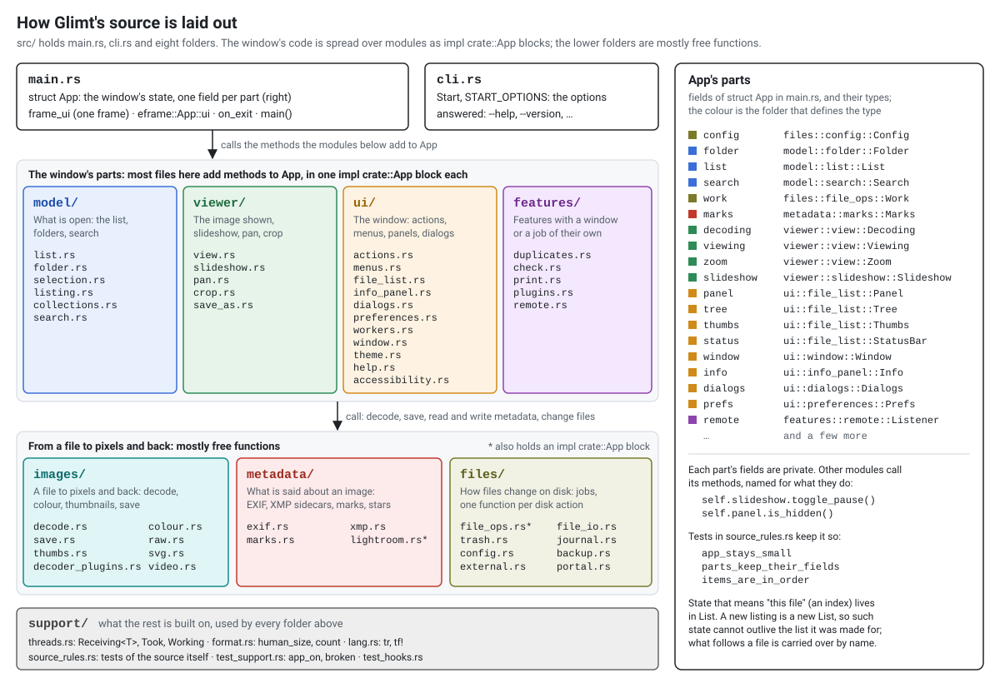
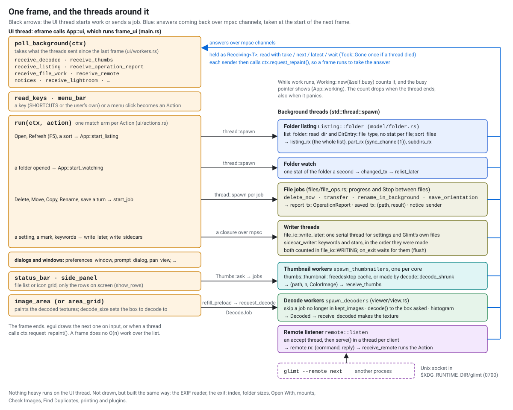
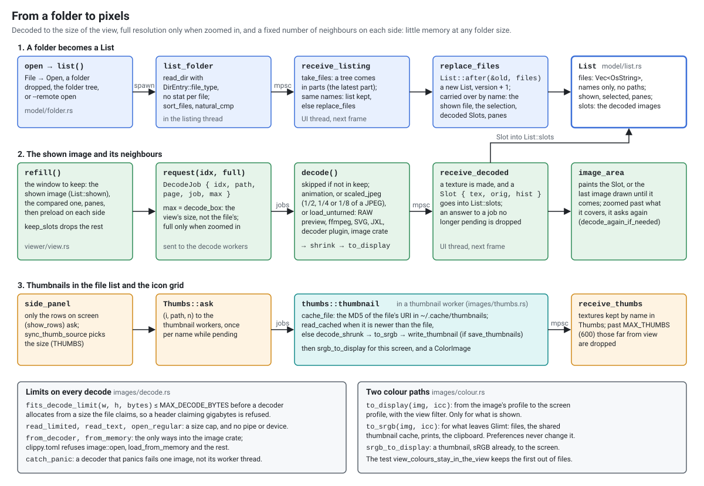
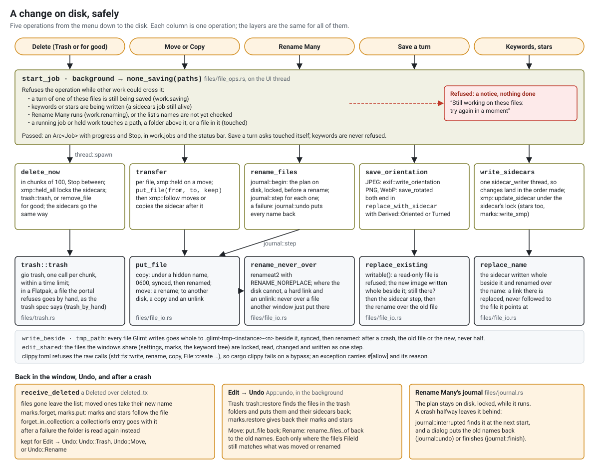
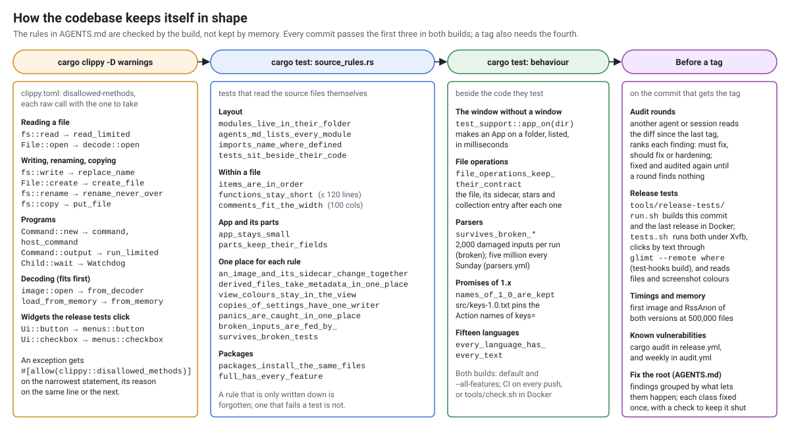

# How Glimt is built

Five diagrams of how Glimt works, for a new contributor and for anyone curious. Every box and
arrow names a real module, function or type, so each one can be looked up in `src/`. AGENTS.md
has the rules in words; these show how they fit together.

## 1. The source layout

Read this first. It shows `main.rs` and `cli.rs`, the eight folders under `src/`, and what each
folder holds. `struct App` in main.rs is the window's whole state, with one field for each part.
Each part is a struct with private fields, defined in the module whose code uses it. The window's
own code is spread over `model/`, `viewer/`, `ui/` and `features/` as `impl crate::App` blocks.
The folders below them hold mostly free functions that those blocks call.

## 2. One frame and the threads

Read this to see why the window stays quick. Each frame, `frame_ui` first takes what the
background threads sent (`poll_background`). It then turns a key or a menu click into an
`Action`, runs it, and draws. Anything slow runs in a thread of its own: listing a folder,
decoding, thumbnails, file jobs, writing Glimt's own files, and the remote socket. Each thread
answers over an `mpsc` channel, held as a `Receiving<T>`, and calls `request_repaint`, so the
next frame picks up the answer. The remote commands are taken in `App::logic` instead, which
eframe runs before each frame and also while the window is minimized or hidden and draws no
frame, so a script gets its answer at once. `App::logic` also guards a close of the window
(`guard_close`), so a minimized window waits for its file jobs before it closes.
A SIGTERM or SIGHUP only counts itself in its handler and wakes a thread, which asks for a
pass. `guard_close` then sees the new count and closes the window as Ctrl+Q does.

## 3. From a folder to pixels

Read this to follow an image from the disk to the screen. A folder is listed in a thread without
a `stat` for each file. The listing becomes a new `List`, and what should stay (the shown file,
the selection, the decoded images) is carried over by name. The shown image and a fixed number of
neighbours are decoded at the size of the view. Thumbnails come from the shared freedesktop
cache. The two boxes at the bottom show the limits that every decode passes, and the two colour
paths: `to_display` for the screen, `to_srgb` for anything that leaves Glimt.

## 4. A change on disk, safely

Read this before you touch a file operation. Every operation first passes `are_free_to_change`, which
refuses it while other work changes the same files. The job then runs in a thread and changes the
disk only through one function for each kind of change. Each of these writes the new file whole
under a hidden name and renames it, and none renames over another file. The answer comes back to
the window: the list, the marks, the stars and the collection entries follow the files, and Undo
is kept. Rename Many writes a journal, so a crash halfway is put right at the next start.

## 5. How the codebase keeps itself in shape

Read this when a check fails and you want to know why it is there. `clippy.toml` refuses the raw
calls for files, programs, decoders and widgets, and names the function to use instead. The tests
in `source_rules.rs` check the layout and the rules that must live in one place. The unit tests
check behaviour without a window. Before a release is tagged, audit rounds and the release tests
compare it with the last release.
